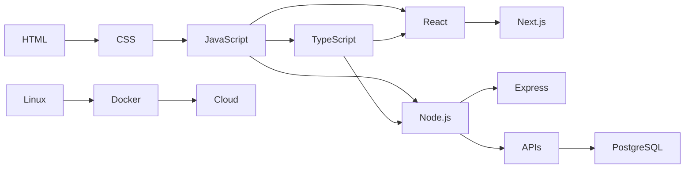

# Coddle Learn — Master Support Knowledge Base & Operations Manual

> **Document Type:** Operational Knowledge Base & Support Representative Runbook  
> **Product:** Coddle Learn (`coddle-learn`)  
> **Product Family:** Coddle Ecosystem (`https://coddle.dev`)  
> **Tagline:** *Learn, Build, Share, Grow.*  
> **Target Audience for this Document:** Customer Support Representatives, Community Managers, Content Moderators, and Engineering Escalation Leads.

---

## Table of Contents

1. [Executive Overview & Platform Philosophy](#1-executive-overview--platform-philosophy)
2. [Platform Identity, SSO & Account Management](#2-platform-identity-sso--account-management)
3. [User Roles, Permissions & Access Levels](#3-user-roles-permissions--access-levels)
4. [Onboarding, Settings & Profile Privacy](#4-onboarding-settings--profile-privacy)
5. [Learning Architecture: Roadmaps, Courses, Lessons & Exercises](#5-learning-architecture-roadmaps-courses-lessons--exercises)
6. [Assessments & Verifiable Credentials](#6-assessments--verifiable-credentials)
7. [Projects & Public Developer Showcase](#7-projects--public-developer-showcase)
8. [The Skill Graph: Evidence-Based Proficiency](#8-the-skill-graph-evidence-based-proficiency)
9. [Competitive Coding Challenges](#9-competitive-coding-challenges)
10. [Community, Social Feeds & Moderation](#10-community-social-feeds--moderation)
11. [Community Mentorship Program](#11-community-mentorship-program)
12. [Developer Tools & External Resources Catalogs](#12-developer-tools--external-resources-catalogs)
13. [Gamification: Points, Leaderboards & Achievements](#13-gamification-points-leaderboards--achievements)
14. [AI Learning Assistant: Architecture & Quotas](#14-ai-learning-assistant-architecture--quotas)
15. [Contributor Studio & Content Review Lifecycle](#15-contributor-studio--content-review-lifecycle)
16. [Administration & Reviewer Queue Operations](#16-administration--reviewer-queue-operations)
17. [Support Runbooks & Troubleshooting Decision Trees](#17-support-runbooks--troubleshooting-decision-trees)
18. [Standard Support Responses (Canned Scripts)](#18-standard-support-responses-canned-scripts)

---

## 1. Executive Overview & Platform Philosophy

### 1.1 What is Coddle Learn?
Coddle Learn is a modern, open-source, interactive developer learning platform. Unlike traditional platforms that passively stream video lectures or isolate users in artificial sandboxes, Coddle Learn unites structured curriculum, real hands-on projects, verifiable credentials, peer mentorship, and an active developer community into a cohesive lifecycle.

### 1.2 The Core Product Loop
Every learning path on Coddle Learn follows this continuous loop:
$$\text{Discover} \longrightarrow \text{Roadmap} \longrightarrow \text{Learn} \longrightarrow \text{Practice} \longrightarrow \text{Build} \longrightarrow \text{Assessment} \longrightarrow \text{Credential} \longrightarrow \text{Share} \longrightarrow \text{Community} \longrightarrow \text{Grow}$$

- **Discover:** Search or browse roadmaps, contributor-created courses, resources, and developer tools.
- **Roadmap:** Choose a guided track (e.g., Frontend, TypeScript, Node.js Backend, Cloud Engineering).
- **Learn:** Absorb modular, text-and-multimedia lessons.
- **Practice:** Solve embedded exercises (tasks, code links, written responses, and interactive quizzes) and algorithmic challenges.
- **Build:** Implement real-world project briefs locally on the developer's computer.
- **Assessment:** Pass course final evaluations covering applied knowledge.
- **Credential:** Earn permanent, cryptographically verifiable, free credentials hosted on unique public URLs.
- **Share & Community:** Publish projects to the public developer showcase, ask questions, write articles, quote peer accomplishments, and engage in mentorship.
- **Grow:** Continuously expand the dynamic, multi-dimensional **Skill Graph**.

### 1.3 Pricing & Open-Source Commitment
- **Is Coddle Learn free?** **Yes, 100% free.** The core platform is open source.
- **Are credentials paid?** **No.** Credentials, certificates, and assessments are completely free to earn and verify.
- **Is there a paywall for lessons or roadmaps?** **No.** There are no artificial locks on content.
- **What is the business model?** Coddle Learn serves as the educational flagship of the Coddle product suite. Future optional enterprise services (such as private organizational workspaces or custom team dashboards) will never restrict the open, public developer experience.

---

## 2. Platform Identity, SSO & Account Management

### 2.1 The Unified Coddle Account (Central Auth SSO)
Coddle Learn **does not manage standalone usernames and passwords**. User authentication is federated through central **Coddle Auth** (`https://auth.usecoddle.com` or Coddle workspace).

#### How the Sign-In Flow Works
```
User visits /login
   ↓
Clicks "Continue with Coddle"
   ↓
Learn initiates: GET /api/auth/coddle/start
(Generates signed, single-use state stored in database table `oauth_states`)
   ↓
Redirects to Coddle Auth (/sso/learn bridge)
   ↓
User logs into Coddle (or approves active session via Google, GitHub, or email/password)
   ↓
Coddle Auth redirects back with one-time authorization code
   ↓
Learn executes: POST /api/auth/coddle/finish
(Server-to-server exchange using LEARN_SSO_CLIENT_ID and LEARN_SSO_CLIENT_SECRET)
   ↓
Learn upserts local `User` record (`coddleUserId`, email, username, name, avatarUrl)
   ↓
Learn sets secure, httpOnly session cookies:
  - `learn_access`: Short-lived JWT (default 15 minutes)
  - `learn_refresh`: Sliding refresh token (default 30 days)
  - CSRF protection cookie
   ↓
User arrives at /onboarding (if new) or /dashboard (if returning)
```

### 2.2 Account Changes, Password Resets & Email Updates
Because identity is centralized:
- **Password Resets:** Support agents must direct users to the central Coddle Account Settings (`https://coddle.dev/settings` or auth portal). Learn agents cannot manually trigger password reset emails.
- **Email & Name Updates:** When a user modifies their primary name, email, or avatar on their Coddle account, changes automatically sync to Coddle Learn the next time they sign in.
- **Social Account Linking:** Linking or unlinking Google or GitHub must be performed in Coddle account settings.

### 2.3 Sign Out vs. Session Termination
- Clicking **Sign Out** in Coddle Learn clears the local `learn_access` and `learn_refresh` session cookies and revokes the active session record in the database.
- Logging out of Coddle Learn **does not** automatically terminate the user's broader Coddle workspace session, providing smooth transitions between other Coddle ecosystem tools.

---

## 3. User Roles, Permissions & Access Levels

Coddle Learn features three distinct user roles:

| Role | System ID | Description & Platform Privileges |
|---|---|---|
| **Learner** | `learner` | The default role assigned to all users upon registration. Has full access to browse catalogs, enroll in roadmaps, take courses, submit exercises, pass assessments, earn credentials, solve challenges, apply for mentorship, post in the community, and create content in Contributor Studio. |
| **Reviewer** | `reviewer` | Trusted community members and content moderators. In addition to all Learner capabilities, Reviewers have access to the **Reviewer Queue (`/reviewers`)** to review, approve, decline, or flag submitted courses, projects, external resources, and tools. |
| **Admin** | `admin` | Platform administrators and operations leads. Full privileges across all routes, including `/admin` (System Overview, User Management, Assistant Usage Diagnostics), `/reviewers` (Content moderation), role reassignment, and account suspension. |

### 3.1 Role Escalation Policy
- A Learner cannot self-promote to Reviewer or Admin.
- Only an existing Admin can grant the `reviewer` or `admin` role via the Admin Users dashboard (`/admin/users`).
- Granting a new role triggers an immediate system notification (`role_granted`) in the recipient's notifications inbox.

---

## 4. Onboarding, Settings & Profile Privacy

### 4.1 The First-Time Onboarding Experience (`/onboarding`)
Upon their initial sign-in, every user is routed to the multi-step onboarding wizard:
1. **Profile Setup:** Confirms synced name, email, and avatar; allows adding an initial bio; prompts selection of an **Experience Level** (`beginner`, `intermediate`, or `advanced`).
2. **Skill Interests:** Selects technology topics of interest from the catalog (e.g., JavaScript, TypeScript, React, Docker, Python).
3. **Roadmap Selection:** The system evaluates the chosen level and skill interests to recommend and select an optimal starting roadmap.
4. **Daily Goal & Routine:** Learner defines their daily learning commitment (15, 30, 45, or 60+ minutes; valid range: 15–120 minutes) and the days of the week they intend to practice.
5. **Launch:** Awards **+50 Points** (`onboarding_complete`), marks `onboardingCompletedAt`, and routes the user to `/dashboard`.

### 4.2 Profile Settings & Public Visibility Toggles (`/profile` & `/settings`)
Learners retain granular control over what information appears on their public portfolio page (`/u/[username]`):
- `showRoadmapsPublic`: Show/hide enrolled roadmaps and step progress.
- `showProjectsPublic`: Show/hide submitted project solutions and showcase links.
- `showPostsPublic`: Show/hide community threads and shares.
- `showSkillsPublic`: Show/hide the interactive Skill Graph and proficiency evidence.
- `showCredentialsPublic`: Show/hide earned verifiable credentials.
- `showAchievementsPublic`: Show/hide badges and milestone awards.

### 4.3 Notification Preferences
In-app notifications are categorized into five groups that users can individually mute/unmute via `/settings?tab=notifications`:
- **Account:** Sign-in alerts, profile updates, and role modifications.
- **Community:** Follows, comments, replies, reactions, and quote posts.
- **Learning:** Course milestones, roadmap completions, project reviews, and challenge solves.
- **Mentorship:** Mentee application submissions, mentor approvals, and program updates.
- **Moderation:** Review decisions regarding user-submitted content.

---

## 5. Learning Architecture: Roadmaps, Courses, Lessons & Exercises

```
                   ┌──────────────┐
                   │   Roadmap    │
                   └──────┬───────┘
                          │ (ordered steps)
                          ▼
                   ┌──────────────┐
                   │ Roadmap Step │
                   └──────┬───────┘
                          │ (curated resources, linked courses)
                          ▼
                   ┌──────────────┐
                   │    Course    │
                   └──────┬───────┘
                          │ (structured modules)
                          ▼
                   ┌──────────────┐
                   │Course Module │
                   └──────┬───────┘
                          │ (ordered lessons)
                          ▼
            ┌─────────────┴─────────────┐
            ▼                           ▼
     ┌─────────────┐             ┌──────────────┐
     │Course Lesson│             │CourseExercise│
     └─────────────┘             └──────────────┘
            │                           │
            └─────────────┬─────────────┘
                          │ (all complete)
                          ▼
                ┌──────────────────┐
                │ Final Assessment │
                └──────────────────┘
```

### 5.1 Roadmaps (`/roadmaps`, `/roadmaps/[slug]`)
- Roadmaps are structured, multi-week learning journeys organized as a vertical timeline of ordered steps.
- **Available Starter Roadmaps:** Programming Foundations, Frontend Developer, TypeScript, Node.js Backend, Cloud Engineering, Go Services, and System Design.
- **Step Actions:**
  - **Complete:** Learner marks the step complete. Awards **+10 Points**.
  - **Skip:** Learner marks the step skipped. Awards **0 Points** (does not penalize overall path completion).
  - Both "Completed" and "Skipped" steps advance overall roadmap progress.
- **Roadmap Completion:** Completing or skipping every step on an enrolled roadmap marks the roadmap complete, awards **+40 Points**, and triggers the `roadmap-completed` achievement.

### 5.2 Courses (`/courses`, `/courses/[slug]`)
- Courses are organized into hierarchical **Modules**, containing individual **Lessons** and attached **Exercises**.
- Lessons include structured Markdown content, code snippets, video embeds, and curated links. Marking a lesson complete awards **+8 Points**.

### 5.3 Lesson Exercises (`CourseExercise`)
Every lesson can contain up to 10 exercises. These provide hands-on practice directly beneath the lesson content:

| Exercise Kind | Learner Action Required | "Done" Criteria | Points Awarded |
|---|---|---|---|
| **Task (`task`)** | Learner performs work locally, ticks off requirements on a checklist, and clicks "Mark Complete". | Marked complete by learner. | **+10 Points** |
| **Link (`link`)** | Learner enters a valid URL (GitHub repository, GitHub Gist, or live deployment URL) demonstrating their work. | Submission of valid URL. | **+10 Points** |
| **Text (`text`)** | Learner writes a substantive answer or reflection (minimum 20 characters, maximum 10,000 characters). | Submission of valid text response. | **+10 Points** |
| **Quiz (`quiz`)** | Learner answers multiple-choice questions graded instantly by the server. | Score meets or exceeds passing threshold (default 80%). Retryable indefinitely. | **+10 Points** |

> **Important Support Distinction:** Submitting a failed quiz marks the submission status as `attempted`. Only reaching the passing threshold sets the status to `completed` and counts toward course progress.

### 5.4 What Exactly Determines 100% Course Completion?
Support frequently encounters learners asking: *"Why is my course stuck at 90% even though I read all the lessons?"*

**The Rule:** A course reaches `completed` status **if and only if**:
1. Every Lesson in every module is marked `completed` or `skipped`.
2. Every Exercise in every module is `completed` (or `submitted`).
3. The Course Final Assessment (if configured) is **taken and passed**.

If a course has a final assessment, the assessment **remains locked** until all lessons and exercises are finished.

---

## 6. Assessments & Verifiable Credentials

### 6.1 Final Assessments (`/assessments`, `/assessments/[id]`)
- Each published course may feature one comprehensive final assessment.
- **Question Types:**
  - `multiple_choice`: Select one correct option among 2–6 choices.
  - `true_false`: Select True or False.
  - `short_answer`: Type an answer; string matching is case-insensitive, normalized for whitespace, and evaluated against accepted variations.
- **Pass Mark:** Defaults to 80% (configurable between 50% and 100%).
- **Time Limits:** Optional timer (5 to 180 minutes).
- **Anti-Cheating Policy:** Correct answers and detailed explanations are **strictly withheld** from the API response until the attempt is officially submitted.
- **Retries:** Learners can retake assessments, but point awards and credentials are only minted upon the **first successful pass**.

### 6.2 Verifiable Credentials (`/credentials`, `/verify/[code]`)
- Credentials on Coddle Learn represent verifiable proof of demonstrated competence.
- **How Credentials Are Issued:**
  1. Passing a course final assessment for the first time (`kind: "assessment"`).
  2. Submitting a verified solution for a practical project for the first time (`kind: "project"`).
- **Public Verification Page (`/verify/[code]`):**
  - Completely public, accessible without logging in.
  - Displays the credential recipient's name, avatar, credential title, issue date, credential kind, and verifiable criteria.
  - **Privacy Guarantee:** Recipient email addresses and private user IDs are never exposed on the public verification view.
  - Learners can freely link this verification URL on LinkedIn, GitHub READMEs, resumes, and personal portfolios.

---

## 7. Projects & Public Developer Showcase

### 7.1 Real-World Project Briefs (`/projects`, `/projects/[slug]`)
- Practical projects bridge the gap between structured tutorials and independent development.
- Each project brief outlines:
  - Estimated hours (e.g., 2–20 hours) and difficulty level.
  - Primary skill slug and secondary tags.
  - Detailed background, user stories, and technical requirements.
  - A concrete "Done Checklist" (minimum 3 verification criteria).
- **Starting a Project:** Learner clicks "Start Project" to create an active submission draft in `project_submissions`.

### 7.2 Submitting & Showcasing
- Once built, the learner returns to the project page and submits:
  - GitHub repository URL (`repoUrl`)
  - Optional live production deployment URL (`liveUrl`)
  - Personal reflections, architecture notes, and challenges overcome (`notes`)
- **Outcome:**
  - Awards **+25 Points** (`project_submit`).
  - Automatically mints a verifiable **Credential**.
  - Unlocks the **First Project** (`first-project`) achievement badge.
  - Elevates tagged skills on the user's **Skill Graph** to `demonstrated` or `credentialed`.
  - Publishes the submission to the user's public portfolio showcase on `/u/[username]`.

---

## 8. The Skill Graph: Evidence-Based Proficiency

Located at `/skills` and embedded on public profiles (`/u/[username]`), the Skill Graph is a distinctive feature of Coddle Learn. It represents directed relationships between technologies (e.g., `html` $\to$ `css` $\to$ `javascript` $\to$ `typescript` $\to$ `react` $\to$ `nextjs`).



### 8.1 The Five Proficiency Tiers
Support agents must clearly understand how skills transition across states:

```
[Locked / Not Started]
       │
       ▼ (User adds skill to interests in onboarding or profile)
 [Interested]
       │
       ▼ (User enrolls in related course/roadmap or starts project)
  [Learning]
       │
       ▼ (User passes final assessment OR submits verified project)
[Demonstrated]
       │
       ▼ (Verifiable Credential issued for that specific skill)
[Credentialed]
```

### 8.2 Why Course Enrollment Alone Does Not "Demonstrate" a Skill
> **CRITICAL SUPPORT PRINCIPLE:**  
> If a user submits a ticket saying: *"I finished reading the React course, why isn't React showing as Demonstrated on my profile?"*  
> **Explanation:** On Coddle Learn, reading material or finishing lessons represents the **Learning** phase. True mastery is **evidence-based**. A skill only transitions to **Demonstrated** when the learner provides tangible proof of work by either:
> 1. Passing the comprehensive Course Final Assessment, OR
> 2. Submitting a completed project tagged with that skill.

---

## 9. Competitive Coding Challenges

Located at `/challenges` and `/challenges/[slug]`, Coding Challenges test problem-solving and algorithmic dexterity.

### 9.1 Challenge Mechanics
- **Difficulties:** Easy, Medium, Hard.
- **In-Browser IDE:** Syntax-highlighted editor with language-specific starter code and explicit function signatures.
- **Server-Side Evaluation:** Submissions execute in an isolated environment against both visible example cases and hidden validation test suites.
- **Submissions Limit:** Maximum 80 submissions per user per challenge to discourage brute-forcing. Submissions are throttled to 1 request per second.

### 9.2 Points & The Early-Solver Rank Bonus
When a learner solves a challenge for the first time, they receive the challenge's base points plus an exclusive **Rank Bonus** depending on how early they solved it relative to all other users globally:

| Solve Order (Global Rank) | Rank Bonus Awarded |
|---|---|
| **1st Person to Solve** | **+50 Bonus Points** |
| **2nd Person to Solve** | **+30 Bonus Points** |
| **3rd Person to Solve** | **+20 Bonus Points** |
| **4th through 10th Person** | **+10 Bonus Points** |
| **11th Person and beyond** | **+0 Bonus Points** (Base points only) |

---

## 10. Community, Social Feeds & Moderation

Located at `/community`, Coddle Learn includes a developer community feed focused on learning and peer feedback.

### 10.1 Post Types & Rich Features
- **Post Kinds:**
  - `question`: Technical or career questions.
  - `discussion`: Architectural debates, learning advice, industry news.
  - `project_share`: Showcasing submitted projects for community critique.
- **Topic Scopes:** `general`, `course`, `roadmap`, `project`.
- **Media Support:** Up to 2 high-resolution image attachments (PNG, JPEG, WebP, GIF) up to 3MB each.
- **Quote Posts:** Users can embed and quote another community post (X/Twitter-style commentary).
- **Two-Level Threading:** Comments attach directly to posts; replies attach directly to parent comments.
- **Reactions:** Standard emoji reactions: 👍, ❤️, 🔥, 💡, 🎉 (one reaction per user per post/comment).

### 10.2 Rate Limits & Safety Policies
- **Daily Post Limit:** Maximum **5 posts per rolling 24 hours** per learner to prevent spam.
- **Creating a Post:** Awards **+5 Points** (`community_post`).
- **Reporting System:** Community members can report posts or comments for:
  - `spam` (Spam or commercial scams)
  - `harassment` (Harassment, bullying, or hate speech)
  - `misinformation` (Technically deceptive or erroneous content)
  - `inappropriate` (NSFW, offensive, or inappropriate content)
  - `other` (Custom reason provided by reporter)

---

## 11. Community Mentorship Program

Located at `/mentors`, `/mentors/[username]`, and `/mentors/me`.

### 11.1 How Mentorship Works
- **Free & Community-Driven:** Mentorship is non-monetized. Experienced contributors volunteer their time.
- **Mentor Profiles:** Mentors configure their headline, bio, years of experience, timezone, topics, and availability:
  - `open`: Actively accepting applications.
  - `limited`: Very few spots available.
  - `waitlist`: Accepting applications to a queue.
  - `paused`: Temporarily not accepting new mentees.
- **Mentorship Topics:** Career guidance, Code review, Project feedback, Technical guidance, Learning advice.
- **Programs & Applications:**
  - Mentors publish discrete programs (e.g., "4-Week Frontend Portfolio Review").
  - Learners submit an application detailing their goals and current blockers (limit: **8 applications per day** across the platform).
  - Mentors review, accept, or decline applications with a custom feedback note.
  - Successfully completing a mentorship program awards the mentor with the `mentor` achievement badge.

---

## 12. Developer Tools & External Resources Catalogs

### 12.1 Developer Tools Catalog (`/tools`, `/tools/[slug]`)
- A curated directory of software, IDE extensions, command-line utilities, hosting providers, and databases.
- Filterable by Category (Workspace, Editor, Terminal, API, DevOps, Hosting, etc.), Pricing (`free`, `freemium`, `paid`), and Platforms (`web`, `mac`, `windows`, `linux`, `cli`, `ios`, `android`).
- Learners can bookmark tools for quick access in `/saved`.

### 12.2 External Resources Catalog (`/resources`, `/resources/[slug]`)
- Curated high-value external references: official documentation (MDN, React Docs), GitHub repositories, video walkthroughs, and in-depth blog posts.
- Any learner can submit a resource via `/contribute` or Studio. Submissions undergo deduplication (URLs are normalized) and review before appearing publicly.

---

## 13. Gamification: Points, Leaderboards & Achievements

### 13.1 Master Points Ledger
Every point awarded or deducted is immutably recorded in the `user_point_events` table:

| Activity | System Event Reason | Points Awarded | Notes |
|---|---|---|---|
| **Finish Onboarding** | `onboarding_complete` | **+50 pts** | One-time award upon completing wizard. |
| **Complete Roadmap Step** | `step_complete` | **+10 pts** | Awarded per step; skipping awards 0. |
| **Complete Entire Roadmap** | `roadmap_complete` | **+40 pts** | Awarded when all steps are complete/skipped. |
| **Complete Course Lesson** | `lesson_complete` | **+8 pts** | Awarded per unique lesson completed. |
| **Complete Lesson Exercise** | `exercise_complete` | **+10 pts** | Awarded when task, link, text, or quiz passes. |
| **Complete Entire Course** | `course_complete` | **+30 pts** | Lessons + Exercises + Final Assessment passed. |
| **Pass Final Assessment** | `assessment_pass` | **+25 pts** | Awarded on the first successful pass. |
| **Submit Practical Project** | `project_submit` | **+25 pts** | Awarded on first submission of repo/live URL. |
| **Create Community Post** | `community_post` | **+5 pts** | Up to 5 posts per rolling 24-hour window. |
| **Solve Coding Challenge** | `challenge_solve` | **Base + Bonus** | Base points + Rank bonus (+50, +30, +20, +10). |

### 13.2 Leaderboards (`/leaderboard`)
- Ranks learners by total accumulated points.
- **Periods:**
  - **All Time:** Lifetime points ledger.
  - **Weekly:** Calculated strictly from the current ISO week (resets every Monday at 00:00:00 UTC).
  - **Monthly:** Calculated from the 1st day of the current calendar month (resets at 00:00:00 UTC).

### 13.3 The 8 Core Achievements (`/achievements`, `/badges`)
Milestones earned automatically by the system or retroactively backfilled:

```
┌─────────────────────────┬──────────────┬────────────────────────────────────────────────────────┐
│ Badge Slug              │ Category     │ How To Earn                                            │
├─────────────────────────┼──────────────┼────────────────────────────────────────────────────────┤
│ first-course            │ Learning     │ Complete every lesson, exercise, and final assessment. │
│ first-project           │ Building     │ Submit a repository or live URL for any project brief. │
│ streak-7                │ Learning     │ Complete an activity on 7 consecutive calendar days.   │
│ open-source-contributor │ Contribution │ Publish a course/project or submit an approved resource│
│ roadmap-completed       │ Learning     │ Complete or skip every step on an enrolled roadmap.    │
│ mentor                  │ Community    │ Approve and complete a mentorship program with a learner│
│ resource-reviewer       │ Contribution │ Approve, decline, or flag submitted community content. │
│ course-creator          │ Contribution │ Author and publish a course in Studio.                 │
└─────────────────────────┴──────────────┴────────────────────────────────────────────────────────┘
```

---

## 14. AI Learning Assistant: Architecture & Quotas

Located at `/assistant`, the AI Assistant helps learners overcome roadblocks, clarifies tricky syntax, explains compiler errors, and guides roadmap progression.

### 14.1 Technical Architecture
- Powered by Google Gemini (with graceful fallback to semantic catalog search if unconfigured).
- The Assistant is aware of the learner's active roadmaps, current enrolled courses, completed steps, and submitted projects to provide contextual, personalized coaching.

### 14.2 Quota & Usage Policies
- **Weekly Allowance:** Every learner receives **10 Assistant messages per UTC week** (`ASSISTANT_WEEKLY_LIMIT = 10`).
- **Reset Timing:** Quotas reset automatically every **Monday at 00:00:00 UTC**.
- **Catalog Search Does Not Consume Quota:** Running global searches via `/search` or filtering catalogs is completely unmetered.
- **Why Is There a Quota?** To ensure sustainable compute allocation for an open, free platform and prevent automated script abuse.

---

## 15. Contributor Studio & Content Review Lifecycle

Located at `/studio`, Contributor Studio empowers community developers and educators to author high-quality courses and project briefs.

### 15.1 The Content Lifecycle State Machine
```
[Draft] ──(Submit for Review)──> [In Review] ──(Admin/Reviewer Approves)──> [Published]
   ▲                                 │                                          │
   │                                 ▼ (Reviewer requests changes)              ▼
   └──────── (Edit & Resubmit) ── [Changes Requested]                      [Archived]
```

1. **Draft:** Author is creating modules, lessons, exercises, or project requirements. Visible only to author.
2. **In Review:** Submitted to the Reviewer Queue. Locked from major edits while under evaluation.
3. **Changes Requested:** Reviewer left actionable feedback. Author can edit and resubmit.
4. **Published:** Live in the public catalog for all learners.
5. **Archived:** Delisted from public discovery, preserved for existing enrollments.

### 15.2 Quality Validation Rules (What Blocks Submission?)
- **Course Studio Validation Checklist:**
  - Course title ($\ge 4$ characters) and summary ($\ge 20$ characters).
  - Estimated hours specified ($1$ to $200$ hours).
  - At least one module with at least one lesson.
  - Every lesson must contain substantive text ($\ge 40$ characters).
  - **Every module must have at least one valid exercise.**
  - If a Final Assessment exists, it must contain at least 3 valid questions.
- **Project Studio Validation Checklist:**
  - Clear title, summary, and detailed markdown body.
  - Primary skill assigned.
  - Associated roadmap selected.
  - **Done checklist must contain at least 3 concrete, verifiable items.**

---

## 16. Administration & Reviewer Queue Operations

### 16.1 The Reviewer Queue (`/reviewers`)
Accessible to users with the `reviewer` or `admin` role.
- **Filter Tabs:**
  - `pending`: Items submitted by contributors awaiting review.
  - `flagged`: Published items reported by community members.
  - `decided`: Historical log of recently approved/declined items.
- **Review Actions:**
  - **Approve:** Immediately advances status to `published` and publishes to the live catalogs. Awards the submitter the `open-source-contributor` achievement.
  - **Decline (Request Changes):** Reverts status to `changes_requested`. Reviewer **must** provide a constructive note explaining what needs revision before approval.
  - **Flag:** Marks an item for senior admin escalation.

### 16.2 The Admin Dashboard (`/admin`, `/admin/users`, `/admin/usage`)
Accessible strictly to `admin` users:
- **User Management (`/admin/users`):**
  - Search any user by username, email, or display name.
  - Filter by role (`learner`, `reviewer`, `admin`) or status (`active`, `suspended`).
  - **Role Reassignment:** Promote trusted users to `reviewer` or `admin`.
  - **Account Suspension:** Suspends abusive accounts immediately, revoking active sessions and blocking API access.
- **Assistant Usage Diagnostics (`/admin/usage`):**
  - Monitor aggregate LLM token usage and conversation volume.
  - Inspect top active assistant users and users who reached their weekly limit.

---

## 17. Support Runbooks & Troubleshooting Decision Trees

### Runbook 1: Login & Authentication Failures
**Symptoms:** User is redirected to `/login?error=signin_failed` or cannot log in with their Coddle account.
```
Step 1: Check Central Coddle Auth Status
  - Is auth.usecoddle.com operational?
  - Can the user log into their main Coddle account directly?
  - IF NOT → Issue is upstream on Central Coddle Auth. Escalate to Identity/Infra team.

Step 2: Browser & Cookie Restrictions
  - Learn uses secure, cross-site, httpOnly session cookies.
  - Ask user: Are third-party cookies or aggressive ad-blockers/Brave shields blocking cookies?
  - Test in an Incognito/Private window.

Step 3: Account Suspension Check
  - Check the Admin Users panel (/admin/users).
  - Is `suspendedAt` populated for this user?
  - IF SUSPENDED → Explain Terms of Service violation or refer to Trust & Safety.
```

---

### Runbook 2: Course Progress Stuck Below 100%
**Symptoms:** *"I completed every lesson, but my course is stuck at 85% and I didn't get my completion badge!"*
```
Step 1: Inspect Lesson Completion
  - Are all lessons marked with a green checkmark?
  - Did the learner inadvertently miss a lesson in an earlier module?

Step 2: Inspect Lesson Exercises (Most Common Cause)
  - Remind the learner: Each lesson has hands-on Exercises below the text content.
  - Did the learner submit all tasks, links, or written answers?
  - If there is an embedded Quiz exercise: Did they pass the quiz? (Status must be "completed", not merely "attempted").

Step 3: Inspect Course Final Assessment
  - Does the course have a Final Assessment?
  - If yes, has the learner started, submitted, and scored $\ge 80\%$ on the assessment?
  - The course cannot complete until the Final Assessment is officially passed.
```

---

### Runbook 3: "Why Isn't My Skill Demonstrated on My Profile?"
**Symptoms:** *"I just finished a course on TypeScript, but my Skill Graph still lists TypeScript as 'Learning'."*
```
Step 1: Explain Evidence-Based Philosophy
  - Explain that Coddle Learn distinguishes between consuming educational content ("Learning") and demonstrating competency ("Demonstrated").

Step 2: Guide to Verification Actions
  - Did the course have a Final Assessment? Passing the assessment will automatically elevate the skill to Demonstrated or Credentialed.
  - Did they submit a practical Project? Completing a project tagged with TypeScript (e.g., building a CLI or API) elevates the skill immediately.
```

---

### Runbook 4: AI Assistant Quota Depleted
**Symptoms:** *"The AI Assistant says I have reached my weekly limit of 10 messages. Can you reset it?"*
```
Step 1: Verify Quota Status
  - Confirm that the weekly limit is 10 messages per user per UTC week.
  - Advise the user that quotas reset automatically every Monday at 00:00:00 UTC.

Step 2: Provide Immediate Alternatives
  - Catalog Search (/search) is completely unlimited and searches all courses, roadmaps, lessons, and resources.
  - Recommend posting technical questions directly in the Community (/community) under the "Question" category.
```

---

### Runbook 5: Contributor Course or Project Submission In Review
**Symptoms:** *"I submitted my new course 4 days ago and it is still pending review."*
```
Step 1: Check Submission in Reviewer Queue (/reviewers)
  - Locate the submission under the "Needs Review" tab.
  - Check if any Reviewer has already flagged issues or left notes.

Step 2: Assess Current Queue Backlog
  - Normal review SLA is 48–72 hours.
  - If overdue, ping the on-duty Community Reviewer team in internal channels.
```

---

## 18. Standard Support Responses (Canned Scripts)

### Script 1: Password Reset / Account Management
> **Subject:** How to reset your Coddle Learn password / account settings  
> 
> Hi there,  
> 
> Thanks for reaching out! Coddle Learn uses unified **Coddle Account Single Sign-On (SSO)**, which means you don't have a separate password stored on Coddle Learn.  
> 
> To update your password, change your email address, or manage two-factor authentication, please visit your central Coddle Account Settings here:  
> 👉 **https://coddle.dev/settings**  
> 
> Once updated there, your changes will automatically reflect on Coddle Learn the next time you sign in. Let us know if you need any additional assistance!  
> 
> Best regards,  
> The Coddle Learn Team

---

### Script 2: Course Progress Stuck (Missing Exercises or Assessment)
> **Subject:** Completing your course on Coddle Learn  
> 
> Hi [Name],  
> 
> Thanks for getting in touch! On Coddle Learn, courses complete only after all lessons, interactive exercises, and the final assessment are finished.  
> 
> Here is a quick checklist to reach 100%:  
> 1. **Check Lesson Exercises:** Scroll to the bottom of each lesson. Ensure all practice tasks, link submissions, and quizzes are completed. (For quizzes, make sure you reached the passing score—quizzes marked as "attempted" still need a passing score).  
> 2. **Final Assessment:** Once all lessons and exercises in every module are completed, the Course Final Assessment will unlock at the bottom of the course overview. Passing this assessment completes the course and awards your credential!  
> 
> Take a look at your course syllabus page to see which module has an unfinished item. If you still have trouble, let us know which course you're taking and we'll gladly investigate!  
> 
> Happy learning,  
> The Coddle Learn Team

---

### Script 3: Skill Graph Status Explanation
> **Subject:** How skills progress on your Coddle Learn profile  
> 
> Hi [Name],  
> 
> Great question! Our **Skill Graph** is built on an **evidence-based proficiency model** rather than passive completion:  
> - **Interested:** Added to your target interests during onboarding or on your profile.  
> - **Learning:** You are enrolled in a roadmap or course covering this technology.  
> - **Demonstrated / Credentialed:** You have proven your skill by **passing the Course Final Assessment** or **submitting a real-world Project** tagged with that skill.  
> 
> Completing the reading material places the skill in the **Learning** stage. To advance it to **Demonstrated**, take the final course assessment or submit a project from our Projects catalog (`/projects`)!  
> 
> Keep up the great work building your portfolio!  
> 
> Cheers,  
> The Coddle Learn Team

---

### Script 4: AI Assistant Quota Inquiries
> **Subject:** Coddle Learn AI Assistant weekly usage limit  
> 
> Hi [Name],  
> 
> Thanks for reaching out. To ensure fair and sustainable access for our entire global community, our AI Learning Assistant is allotted **10 messages per user per week**.  
> 
> Your message quota resets automatically every **Monday at 00:00:00 UTC**.  
> 
> In the meantime, you can:  
> - Use our **Global Search (`/search`)**, which is completely unlimited across all courses, roadmaps, and code examples.  
> - Post your question in our **Community Feed (`/community`)**—our community members and mentors are always eager to help!  
> 
> Thank you for your understanding and for being part of Coddle Learn!  
> 
> Best,  
> The Coddle Learn Team

---

### Script 5: Sharing and Verifying Credentials
> **Subject:** How to share and verify your Coddle Learn credentials  
> 
> Hi [Name],  
> 
> Congratulations on earning your credential!  
> 
> All credentials on Coddle Learn are 100% free, authentic, and publicly verifiable. To share your achievement:  
> 1. Head to your **Credentials page (`/credentials`)** and click on your credential.  
> 2. Copy the **Public Verification Link** (format: `https://learn.coddle.dev/verify/YOUR_CODE`).  
> 3. You can paste this URL directly into your LinkedIn profile under "Licenses & Certifications", link it in your resume, or share it on GitHub and X (Twitter).  
> 
> Anyone who clicks your verification link can view proof of your demonstrated skills without needing an account.  
> 
> Keep building!  
> The Coddle Learn Team
